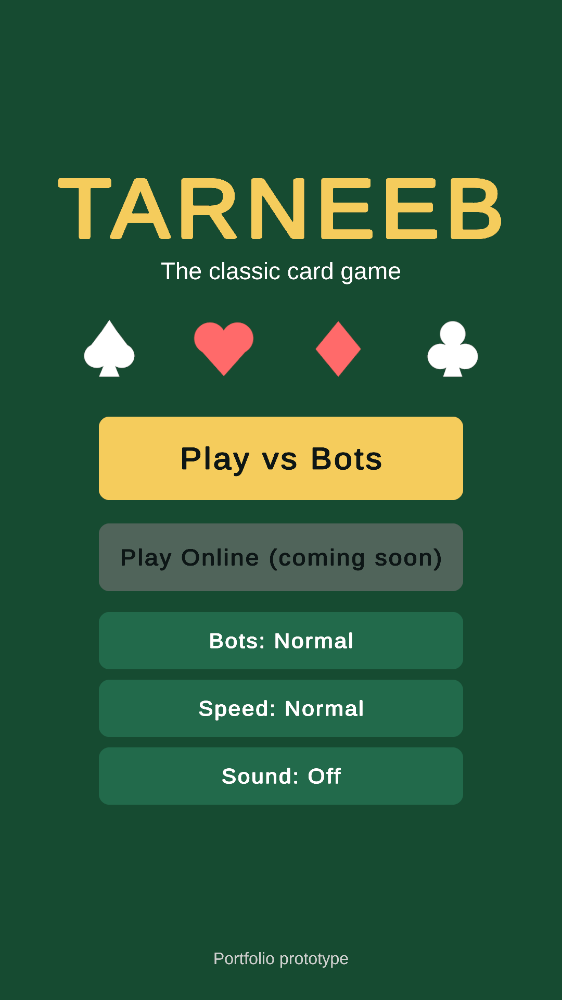
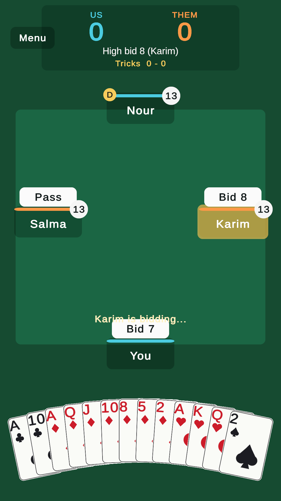
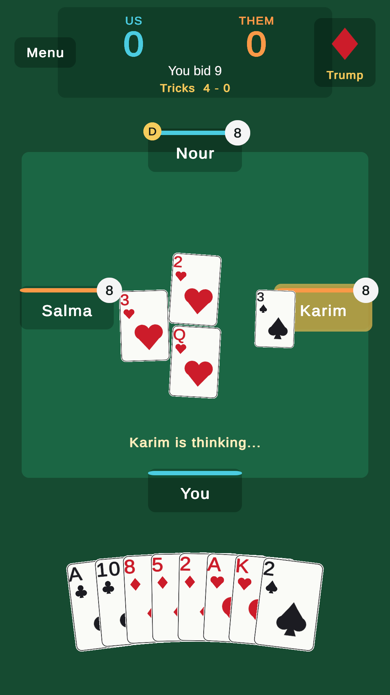
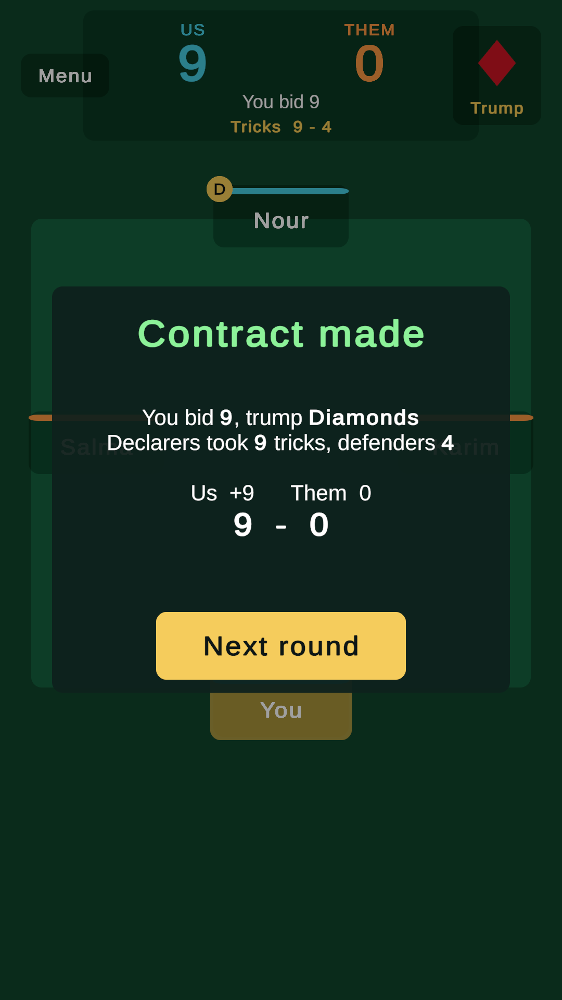

# Tarneeb

A polished single-player **Tarneeb** (the classic Levantine trick-taking card game) for the browser, built in Unity 6 as a
portfolio prototype. Portrait, mobile-first, four players (you and your partner against two opponents), heuristic bots and a
small (about 11 MB) WebGL build. Online multiplayer is implemented and tested, but switched off until a Photon account is
connected.

- **Play:** _the itch.io link goes here after the first upload (it needs the developer's account)._ The exact build is produced
  in `Build/WebGL` by `Tools/build_webgl.sh`, and any static host works (`python3 -m http.server -d Build/WebGL`).
- **Screenshots:** in `Docs/screens/`, rendered from the real game by the PlayMode tests.

| Menu | Bidding | Playing | Round summary |
|---|---|---|---|
|  |  |  |  |

## Architecture

Strict separation between pure game logic and Unity presentation.

```
   input         Presentation               Game                       Core (pure C#, no UnityEngine)
 (tap / flick)   CardView, HandView         GameController             TarneebEngine
      |          SeatView, HudView          MatchLoop  ------------->    commands in, events out
      v          BidPanel, popups           SeatController:            GameState, TarneebRules
   TableView <---------- ordered queue of GameEvents <----------------  HeuristicBot, CardTracker
   (renders events one at a time, never mutates game state)             RulesConfig (every variant)

   Net (Photon, disabled):  NetHost = authoritative master   NetClient = replica engine fed by accepted commands
```

- `Assets/_Project/Scripts/Core` has its own asmdef with `noEngineReferences`: cards, rules, engine, events and bots.
  The engine returns a `CommandResult` for illegal moves and never throws for them; every shuffle uses an injected seed,
  so any game can be replayed exactly.
- **Seats, not players.** Seats 0 and 2 are Team A, seats 1 and 3 are Team B. A `SeatController` (human, bot, remote, net)
  decides for a seat, and `MatchLoop` runs the game, asking a seat to act only after the table has finished presenting
  every queued event.
- **Presentation only reacts to events.** The engine resolves instantly; `TableView` plays each event as an animation
  (deal, play, trick collection) in order, using a small coroutine tween (`Tween.cs`).
- **Online** (`Scripts/Net`, see its README): the master owns the only real engine and broadcasts the *accepted commands*.
  Each client runs a replica engine on those commands, so the same views render an online game and hidden hands are only
  ever sent to their owner. Eight tests drive a host and three clients in-process.

## Rules implemented

Every variant is a `RulesConfig` field; the defaults are classic Tarneeb.

| Rule | Default | Config |
|---|---|---|
| Four players, fixed partnerships (partners opposite), 52 cards, ace high, 13 cards each | | |
| Play direction | counterclockwise | `Counterclockwise` |
| Bids are a number of tricks, each higher than the last; a pass is final; bidding ends when three have passed after a bid | 7 to 13 | `MinimumBid`, `MaximumBid` |
| All four pass | redeal, next dealer | `RedealOnAllPass` (off: the dealer is stuck with the minimum bid) |
| Declarer names trump and leads the first trick | on | `DeclarerLeadsFirstTrick` |
| Follow suit if able, otherwise any card; highest trump wins, else highest card of the led suit | | |
| Contract made: declarers score their tricks, defenders 0 | | `DefendersScoreWhenContractMade` |
| Contract failed: declarers lose the bid, defenders score their tricks (scores can go negative) | | |
| Bid 13 and take all 13 (kaboot) | 16 points | `KabootBonusScore` |
| First team to 41 wins; if both cross in one round the declaring team wins | 41 | `TargetScore` |
| Human turn timer in online games (a bot plays on timeout) | 15 s | `TurnTimerSeconds` |

Bots (`HeuristicBot`, behind `IBot`) evaluate the hand (aces, protected kings and queens, a long suit) plus a partner
allowance to decide bids, track played cards and shown voids, lead winners and draw trumps, win with the cheapest card,
play low when the partner is winning and trump in when void. Easy plays a random legal card 30% of the time.

## Tests

| Suite | Count | Result |
|---|---|---|
| EditMode (NUnit): deck, deal, determinism, bidding, follow suit, trick winner, scoring, game end, full bot games, online host and clients | **50** | all pass |
| PlayMode: a full game with bots only, a **full game played through the real UI** (button clicks and card taps), screenshot renders | **4** | see DEVLOG for the last run |
| Headless simulation | 10,000 bot games | **0 errors, 5.4 s** (0.54 ms per game) |

The simulation covered 91,849 rounds and 1.19 million tricks: every round had exactly 13 tricks and 52 cards, every game
terminated, no bot ever made an illegal move, 74% of contracts were made and no round ended in an all-pass loop.

Run them with `Tools/run_tests.sh EditMode` and `Tools/run_tests.sh PlayMode` (they close the Editor, run headless and print
a summary).

## AI-assisted workflow

_The developer writes the final version of this section._ Notes to build it from are in `DEVLOG.md` (what the agent built,
the decisions, the bugs found and every place AI output was rejected or corrected). How validation worked:

- Claude Code wrote the C#, the tests and the generators, and NAV MCP built the scenes. Nothing was trusted until a test or a
  rendered screenshot had checked it.
- Layers of checks: rule tests written with the engine, a 10,000-game simulation as a regression net for the bots, a PlayMode
  test that plays a whole game through the UI, and PNG renders of the actual scene (that is how a 3x scale bug and clipped seats
  were found).
- Concrete corrections: bot bidding was tuned from a parameter sweep (2.2 redeals per round before, none after), a
  replay-forever bug in the remote controller was caught by the tests, two MonoBehaviours in one file lost their script
  reference, and NAV MCP's world-position parenting inflated the UI scale.

## Built with NAV MCP

All Editor work went through [NAV MCP](https://github.com/Biltoa/nav-mcp-unity) (v1.0.2, its first run on a physical Mac):
the two scenes (about 130 GameObjects, 500+ operations in batches of at most 30), the `CardView` prefab, component values, the
build scene list, WebGL validation and audio import settings, plus compile and console checks after every script change.
`Tools/build_scenes.py` regenerates the whole UI from a spec through the daemon's MCP endpoint.

Tally from NAV MCP's own audit log (`~/Library/Application Support/UnityMCP/logs/audit.jsonl`) when this was written: about
250 audited calls, roughly 140 `unity_batch` (up to 30 operations each), 75 `unity_script`, and the rest single operations
(`scene.*`, `build.*`, `audio.*`, `prefab.*`). `unity_script` was needed wherever no operation exists (Player Settings, sprite
import, TMP essentials, sprite and audio references). WebGL validation over time: 0 errors / 6 warnings, then 0 / 0.

What was found and should be fixed in NAV MCP (details and severity in `NAV_MCP_FIELD_NOTES.md`):

1. **The package does not compile on Unity 6000.6** (about 50 obsolete-API errors) and nothing says so; the Editor just never connects.
2. `component.set` reports success but leaves a Sprite field null when given a texture path.
3. `gameobject.create` with a parent keeps the world transform, so children of a scaled UI parent get a compensating scale.
4. `gameobject.create` under a UI parent does not create a RectTransform, although the error hint says it does.
5. `build.scenes` changes are not persisted until the assets are saved.
6. There are no operations for Player Settings, sprite import, running tests, building a player or taking a screenshot.

## Known limitations and what would come next

- **Not on itch.io yet, online is off.** Both need the developer's accounts (itch.io upload, Photon App ID). Everything else
  is done, and `Assets/_Project/Scripts/Net/README.md` lists the five steps that enable online play.
- Host migration is out of scope: if the master leaves, the online match ends with a message.
- The bots have no partner signalling or opponent modelling and never reach a kaboot. A production version would tune
  difficulty tiers from real play data (the seeded replays and the simulation harness make that cheap).
- Portrait only (letterboxed on desktop) and no Arabic or RTL text yet. That is the highest-value next feature and needs an
  RTL solution for TextMeshPro plus a font with Arabic glyphs.
- DOTween was replaced by a small in-house tween, and the audio is generated placeholder-quality effects.
- It has not been tried on real phones (Chrome on Android, Safari on iOS) from this environment; only headless renders and a
  desktop browser were used.
- Analytics events, a hint button and card-back themes are not started.

## Time spent

About 6 hours of wall-clock time in one unattended session (a good part of it waiting on Unity imports, test runs and the 6.5-minute WebGL build): NAV MCP install and setup, the engine and tests, the UI and scenes,
the WebGL build, the online layer and the docs. The Unity 6000.6 / NAV MCP incompatibility and the multiplayer layer each cost
roughly an hour.

## Working in the repo

```bash
Tools/open_editor.sh            # open Unity 6000.3.25f1 and wait for NAV MCP to connect
python3 Tools/build_scenes.py   # rebuild scenes and prefab through NAV MCP (idempotent)
Tools/run_tests.sh EditMode     # headless tests (closes the Editor first)
Tools/build_webgl.sh            # WebGL build into Build/WebGL
python3 Tools/gen_art.py        # regenerate the sprites and sound effects
```

Unity **6000.3.25f1** with the WebGL module. Original or CC0 assets only; no third-party art, audio or code.
