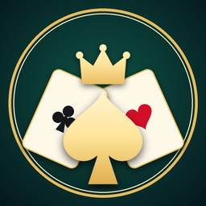
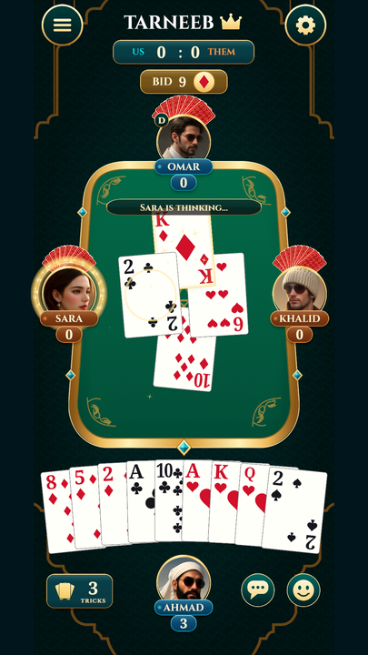
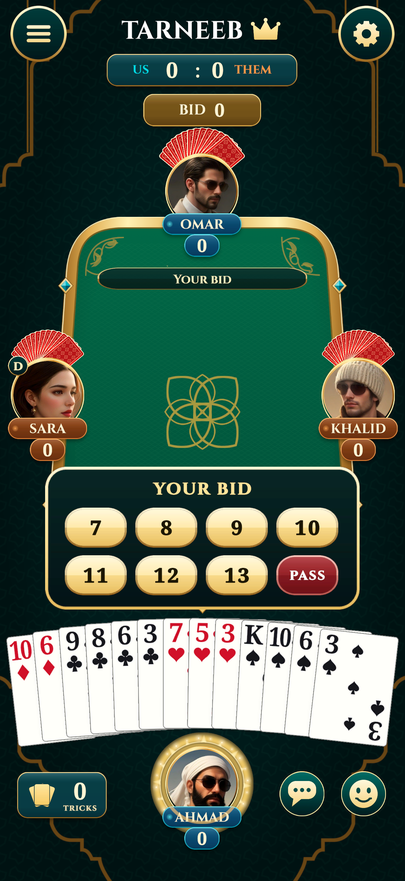
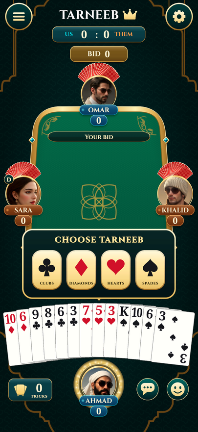
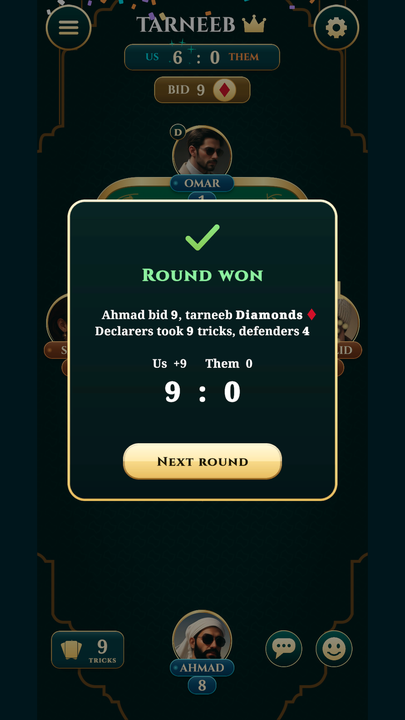
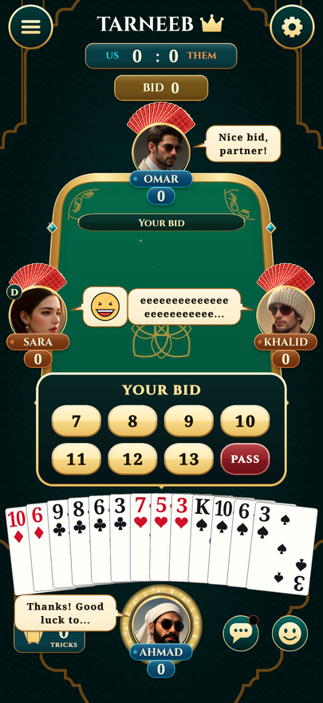
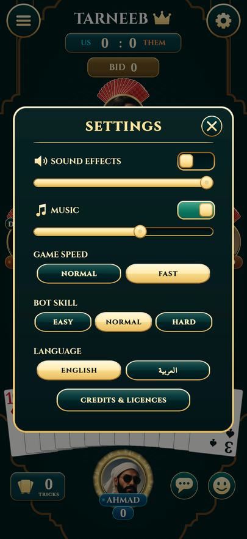
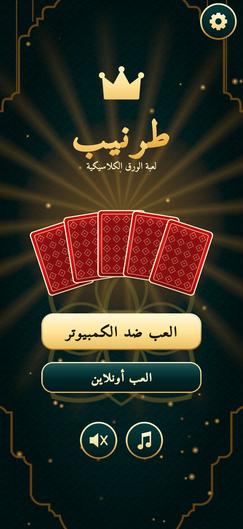
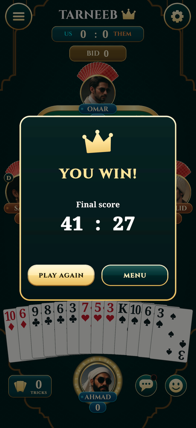

<div align="center">



# Tarneeb

**The classic Levantine trick-taking card game, in your browser.**

Portrait, mobile-first, four players. Single player against bots, or online with friends. Arabic and English.

[**▶ Play now**](https://ahmadbilto.com/tarneeb/) &nbsp;·&nbsp; [Credits](CREDITS.md) &nbsp;·&nbsp; [Dev log](DEVLOG.md)

<sub>A <b>Tazigra</b> game · Unity 6 · WebGL · about 20 MB</sub>

</div>

<br>

<div align="center">

| Playing | Bidding | Choose tarneeb | Round won |
|:---:|:---:|:---:|:---:|
|  |  |  |  |

| Chat and emoji | Settings | Arabic (RTL) | Game over |
|:---:|:---:|:---:|:---:|
|  |  |  |  |

</div>

## Features

- **Full Tarneeb rules**: bidding 7 to 13, declarer names the tarneeb (trump), follow suit, kaboot bonus, first team to 41. Every variant is a field of `RulesConfig`.
- **Three bot levels**: Easy, Normal (heuristic) and **Hard** (Monte Carlo search over the cards it cannot see).
- **Online multiplayer** on Photon: quick match, bots fill empty seats, a host-authoritative server, a 15 second turn timer.
- **Chat and emoji**, with speech bubbles at the seats.
- **Arabic and English**, with proper letter joining and right-to-left layout.
- **Made for thumbs**: drag a card toward the table (past 25% of the way and it plays, release earlier or pull it back and it returns to your hand), or tap twice. It never plays a card for you, even when only one is legal.
- Generated sound effects and two music loops, animated deal and tricks, settings, pause menu, game speed.

## How it is built

| | |
|---|---|
| **Engine** | Unity 6 (6000.3.25f1), URP, uGUI and TextMesh Pro, C# |
| **Platform** | WebGL (Brotli with decompression fallback), hosted on GitHub Pages |
| **Game logic** | Pure C# assembly with no `UnityEngine` reference: engine, rules, bots, seeded shuffles |
| **Networking** | Photon PUN 2, master-authoritative, replica engines on the clients |
| **UI design** | Figma, imported into Unity with a Figma-to-Unity plugin (the plugin has since been removed from the project) |
| **Assets** | Cards, icons, effects, music and the game icon are drawn or synthesised by Python scripts in `Tools/` (Pillow, NumPy, SciPy); portraits made with FLUX through Pollinations |
| **Fonts** | Cinzel, Noto Serif, Amiri (all SIL OFL) |
| **AI assistants** | **Claude Sonnet 5.5** (medium effort) in Claude Code wrote the engine, bots, UI code, tests and tooling; **ChatGPT Sol 6.1** (medium effort) alongside it |
| **Editor automation** | [NAV MCP](https://github.com/Biltoa/nav-mcp-unity), so the AI could drive the Unity Editor directly |
| **Tests** | NUnit: 75 EditMode, 11 PlayMode (including a whole game played through the real UI), a 10,000-game bot simulation |

## Architecture

Strict separation between pure game logic and Unity presentation.

```
   input         Presentation               Game                       Core (pure C#, no UnityEngine)
 (tap / drag)    CardView, HandView         GameController             TarneebEngine
      |          SeatView, HudView          MatchLoop  ------------->    commands in, events out
      v          BidPanel, popups           SeatController:            GameState, TarneebRules
   TableView <---------- ordered queue of GameEvents <----------------  HeuristicBot, SearchBot
   (renders events one at a time, never mutates game state)             RulesConfig (every variant)

   Net (Photon):  NetHost = authoritative master   NetClient = replica engine fed by accepted commands
```

- `Assets/Core Game Assets/Scripts/Core` has its own asmdef with `noEngineReferences`. The engine returns a `CommandResult` for
  illegal moves instead of throwing, and every shuffle uses an injected seed, so any game can be replayed exactly.
- **Seats, not players.** Seats 0 and 2 are Team A, seats 1 and 3 are Team B. A `SeatController` (human, bot, remote, net) decides
  for a seat, and `MatchLoop` runs the game, asking a seat to act only after the table has finished presenting every queued event.
- **Presentation only reacts to events.** The engine resolves instantly; `TableView` plays each event as an animation in order.
- **Online** (`Scripts/Net`, see its README): the master owns the only real engine and broadcasts the *accepted commands*. Clients
  run a replica engine on those commands, so the same views render online and offline games, and hidden hands are only ever sent
  to their owner.

## Rules implemented

Every variant is a `RulesConfig` field; the defaults are classic Tarneeb.

| Rule | Default | Config |
|---|---|---|
| Four players, fixed partnerships (partners opposite), 52 cards, ace high, 13 cards each | | |
| Play direction | counterclockwise | `Counterclockwise` |
| Bids are a number of tricks, each higher than the last; a pass is final; bidding ends when three have passed after a bid | 7 to 13 | `MinimumBid`, `MaximumBid` |
| All four pass | redeal, next dealer | `RedealOnAllPass` |
| Declarer names trump and leads the first trick | on | `DeclarerLeadsFirstTrick` |
| Follow suit if able, otherwise any card; highest trump wins, else highest card of the led suit | | |
| Contract made: declarers score their tricks, defenders 0 | | `DefendersScoreWhenContractMade` |
| Contract failed: declarers lose the bid, defenders score their tricks (scores can go negative) | | |
| Bid 13 and take all 13 (kaboot) | 16 points | `KabootBonusScore` |
| First team to 41 wins; if both cross in one round the declaring team wins | 41 | `TargetScore` |
| Human turn timer in online games (a bot plays on timeout) | 15 s | `TurnTimerSeconds` |

## Tests

| Suite | Count | Result |
|---|---|---|
| EditMode: deck, deal, determinism, bidding, follow suit, trick winner, scoring, game end, bot behaviour and strength ladder, online host and clients, Arabic shaping | **75** | all pass |
| PlayMode: a full game with bots, a full game played through the real UI, drag-to-play, chat, online lobby, UI and language flows | **11** | all pass |
| Headless simulation | 10,000 bot games | 0 errors, every game terminates, no illegal move |

```bash
Tools/run_tests.sh EditMode     # closes the Editor, runs headless, prints a summary
Tools/run_tests.sh PlayMode
```

## Working in the repo

Unity **6000.3.25f1** with the WebGL module.

```bash
Tools/open_editor.sh            # open the Editor and wait for NAV MCP to connect
Tools/build_webgl.sh            # WebGL build into Build/WebGL
python3 Tools/gen_ui_art.py     # regenerate UI sprites (also gen_cards, gen_audio, gen_icon, gen_portraits)
```

**Online play needs Photon PUN 2**, which is a 39 MB Asset Store package and is not in this repository. Without it the menu shows
"Play Online (unavailable)" and everything else works. `Assets/Core Game Assets/Scripts/Net/README.md` lists the steps to enable it.

The published site is the contents of `Build/WebGL`, committed under `docs/` and served by GitHub Pages.

## Known limitations

- Host migration is out of scope: if the online master leaves, the match ends with a message.
- The bots have no partner signalling or opponent modelling and never reach a kaboot.
- Typed chat is Latin-only; the quick phrases and the interface are fully translated.
- Portrait only: on desktop it is letterboxed, and on a phone held sideways it asks you to rotate.
- The four player portraits are AI-generated and the image service's terms are not a formal licence (see [CREDITS.md](CREDITS.md)).

<div align="center"><sub>© Tazigra</sub></div>
